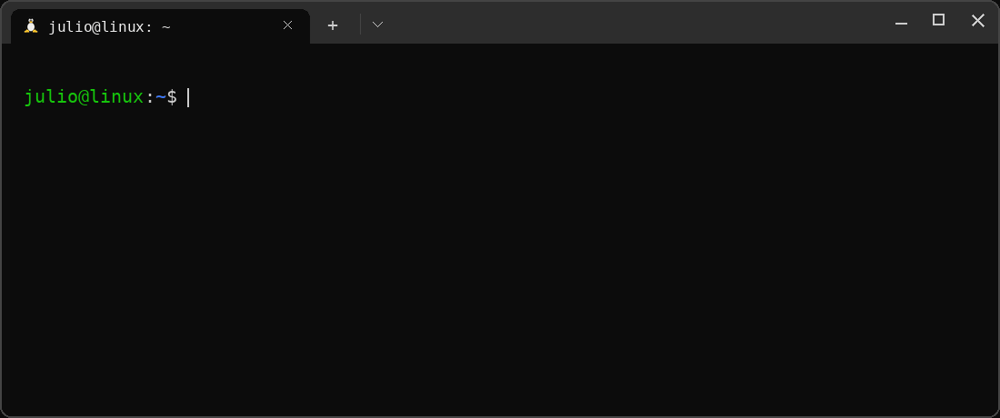

# Hey, I'm Julio

I work in web analytics, build practical tools with Python, and enjoy
Linux and command-line workflows. I'm also the co-creator of
[DragonBallDle](https://dragonballdle.site).

### Featured projects

| Project | Description |
| --- | --- |
| [DragonBallDle](https://dragonballdle.site) | A Dragon Ball Wordle-like web project I co-created and help build, maintain, and run. |
| [Audio Atlas](https://github.com/juliovpi-dev/decupador-audio-multifaixa) | A local Python tool for cataloging and clipping multilingual audio tracks from video files, powered by FFmpeg. |
| [GIF Variant Studio](https://github.com/juliovpi-dev/gif-variant-studio) | A local GIF and video catalog for comparing five visual variants side by side, built with Python, SQLite, and FFmpeg. |

### $ ./minesweeper

My contributions, with a little arcade twist.

<picture>
  <source media="(prefers-color-scheme: dark)" srcset="assets/minesweeper-contribution-graph-dark.svg">
  <source media="(prefers-color-scheme: light)" srcset="assets/minesweeper-contribution-graph.svg">
  
</picture>

### Tools & interests

- **Web analytics** — understanding how people interact with websites.
- **Python** — building practical tools and automating repetitive tasks.
- **Linux & CLI** — exploring the system and working from the terminal.
- **Personal projects** — learning by building and maintaining things.

### Contact

[Website](https://dragonballdle.site) ·
[Instagram](https://www.instagram.com/juliovpi/)
